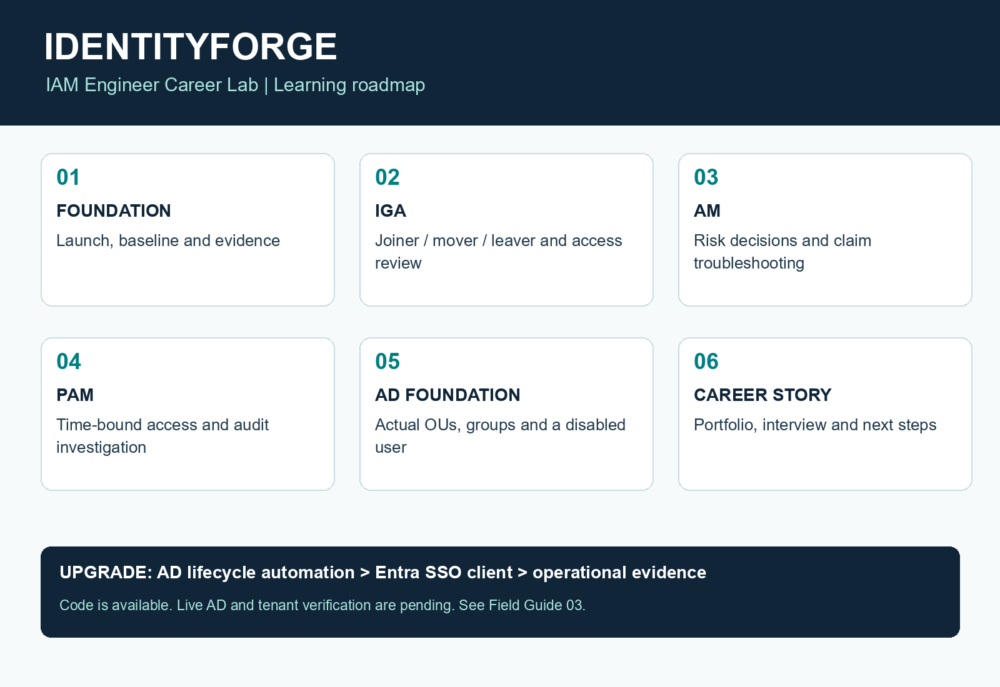

# IdentityForge: IAM Engineer Career Lab

**Status: In progress - actively building and validating. This project is not complete.**

PowerShell tooling, the local SSO client and self-paced guides are available. Live Active Directory lifecycle execution, real Entra sign-in/break-fix verification and sanitized live evidence are still pending. See [verification status](portfolio/VERIFICATION.md) for the distinction between offline checks and live results.

Learn identity. Build evidence. Tell your career story.

## Meridian IAM Range: download and practise

[**Download the Windows installer**](https://github.com/pitchiluxe/identityforge-iam-lab/releases/latest) (Windows 10/11, 64-bit, free). The installed app updates itself from this repository's releases. Sign in as **Admin**; the default password `Meridian!2026` is shown on the sign-in screen. The installer is not code-signed yet, so SmartScreen may ask you to choose **More info**, then **Run anyway**.

Meridian IAM Range is a simulated IAM Operations workstation at a fictional hospital system, Meridian Health System: Active Directory Users and Computers, PowerShell and the ISE, Chrome with Entra ID, Okta, ServiceDesk and HR portals, Event Viewer, and an IAM Copilot that watches every lab. Rather not install? The landing page has a web edition of the same lab at `/lab/` that runs in the browser. Source: [range/](range/README.md). Landing page source: [site/](site/) (deployed with Vercel using [vercel.json](vercel.json)).

## Practice path to an IAM job

1. **Daily reps in Meridian IAM Range** (the installer above, `Start-Lab.cmd` option 9, or `range\Start-Range.ps1`). A simulated Meridian Health System workstation: tickets in ServiceDesk, HR in PeopleHub, ADUC, PowerShell, Entra and Okta admin consoles, SaaS apps, policies on disk. 17 scenario types and 35 variations, randomised every run, plus AI-designed labs if Ollama is running. Do one lab a day and a 5-ticket shift each weekend. See [range/README.md](range/README.md).
2. **Prove it on real systems** with the AD lifecycle track (`advanced/lifecycle/README.md`) on an isolated Windows Server VM, and the Entra SSO client (`sso/README.md`) on a free lab tenant. The Range's "Real portals" bookmarks link to the sign-up pages.
3. **Turn practice into evidence:** IAM Coach exports a Markdown evidence pack per lab; Career Tracker exports your coverage against IAM job descriptions. Label Range work as simulated, and live work as live.
4. **Interview:** each Range lab ends with an interview question; Ollama scores your answer, or you compare it with the reference answer. `INTERVIEW.md` has more.

The original standalone console (`Lab.ps1`, option 3) is the short warm-up; the Range is the main practice environment.

## Project milestones

- [x] Standalone IGA, AM and PAM simulation.
- [x] CSV-driven AD lifecycle scripts, preview, error handling and audit logs.
- [x] Entra MSAL browser client and application mapping break/fix exercise.
- [x] Local automated checks, operational worksheets and PDF guides.
- [ ] Verify joiner, mover and leaver execution in an isolated AD domain.
- [ ] Register an isolated Entra lab tenant application and verify live SSO failure/recovery.
- [ ] Publish reviewed, sanitized evidence from the live exercises.
- [ ] Extend and verify hybrid synchronization and cloud access policies.

Double-click **Start-Lab.cmd** for the formatted home menu. It opens the PDF guides, starts the standalone practice console, opens AD Checkpoint 1, or shows saved evidence.

## Hiring asset upgrade

Start with **HIRING-ASSET-START-HERE.md** for real CSV-driven AD lifecycle automation, controlled initial activation, per-identity failure handling, audit evidence, an Entra MSAL sign-in client, operational decision worksheets and a portfolio source exporter. See portfolio/README.md for implemented versus live-verified status. No AD endpoint or cloud tenant is currently available, so live AD and SSO remain pending.

## PDF guides and portfolio assets

- `output/pdf/IdentityForge-Getting-Started-and-Lab-Handbook.pdf`: first launch, step-by-step scenarios, Windows Server setup, AD checkpoint and completion checklist.
- `output/pdf/IdentityForge-Roadmap-and-LinkedIn-Playbook.pdf`: recommended learning schedule, eight milestone posts, image workflow and portfolio checklist.
- `output/pdf/IdentityForge-Hiring-Asset-Upgrade.pdf`: real AD lifecycle runbook, Entra SSO setup/break-fix, operational worksheets and verification status. Launcher option 6 opens it.
- `LINKEDIN-TEMPLATES.md`: editable post copy. Replace bracketed fields and use only verified accomplishments.
- `output/images/IdentityForge-Roadmap.png`: shareable learning roadmap (not a completion certificate).
- `output/images/Milestone-01-Image-Layout.png` through `Milestone-08-Image-Layout.png`: screenshot layout references. Add your own evidence in a slide/image editor; these are not actual result screenshots.

The default launcher respects your saved PowerShell policy. See the handbook or the process-only launch command below if personal-lab script execution is blocked.

Start here. This portable Windows lab covers IGA, AM, PAM, portfolio evidence, and interview preparation. No subscription, installation, administrator rights, Python, or Ollama is required for the core exercises.

**Two tracks:** use WORKBOOK.md for the complete standalone simulation, or advanced/CHECKPOINT-01.md followed by advanced/lifecycle/README.md for actual Active Directory. The advanced track requires a separate isolated AD domain. Its lifecycle checkpoints are now available for self-paced execution. SSO setup is in sso/README.md and needs a lab tenant.

## Launch

Double-click **Start-Lab.cmd** in this folder. Keep the menu open and read **WORKBOOK.md** alongside it. To edit a JSON file, right-click it and choose Open with > Notepad. Save before running the relevant menu action again.

If Windows blocks script execution, open PowerShell in this folder and run `powershell.exe -NoProfile -ExecutionPolicy Bypass -File .\Lab.ps1`. This applies only to that new process. On an organization-managed device, follow its policy rather than overriding enforcement.

Your work is saved automatically in `workspace/state.json`; editable rules live beside it. Evidence exports and append-only exercise events go into `evidence`. Menu R resets exercise state and editable rules after you type RESET; old evidence remains. Copy evidence into a dated subfolder before a new attempt because CSV reports use fixed filenames.

## What the standalone simulation does

- IGA: reconcile synthetic identities against HR, provision joiners, replace mover access, disable leavers, and export compliance findings.
- AM: evaluate four risk cases and troubleshoot required claims in a simulated token.
- PAM: request and approve a simulated two-hour grant, test authorization before and at expiry, and investigate session logs.
- Interview: five questions with a self-scoring framework and model answers.

This is a production-inspired **simulation**, not a deployed directory, federation server, MFA service, or PAM product. JSON is editable and is not a secure vault. AM tokens are unsigned fixtures, not real OIDC/SAML authentication. PAM grants never confer Windows or domain permissions. The clock advances only through the menu; there is no background revocation service. Real systems must enforce expiry at every authorization boundary, terminate applicable sessions, protect secrets and audit evidence, and enforce independent approval. Menu checks assess selected outcomes, not production readiness.

Use only fictional data. No real credentials belong in this folder. The core lab performs no network calls.

## Files

- WORKBOOK.md: exercises and completion gates.
- ANSWER-KEY.md: solutions and expected evidence.
- INTERVIEW.md: independent interview simulator and rubric.
- Lab.ps1 / Start-Lab.cmd: reusable environment.
- templates: initial policies and session log.
- workspace: generated working state (created on first launch).
- evidence: generated reports and events (created on first launch).

Optional Ollama use: ask a local model to critique your written explanations using synthetic data only. It is never the authority for an access decision. Your initial connectivity check is recorded in this chat; model inference remains unverified. If a model name contains `cloud`, do not assume its inference is local.
